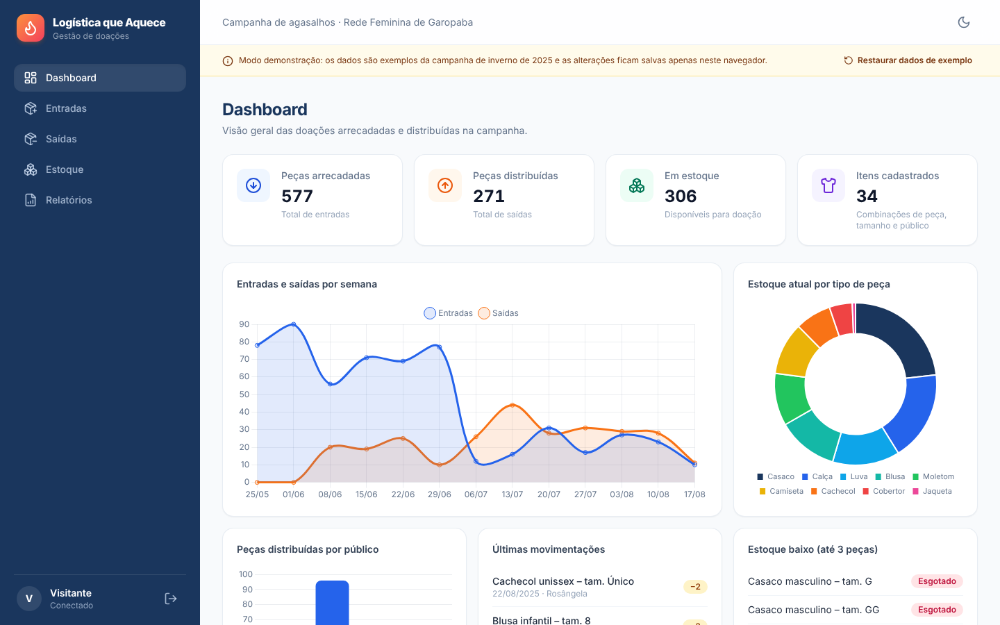
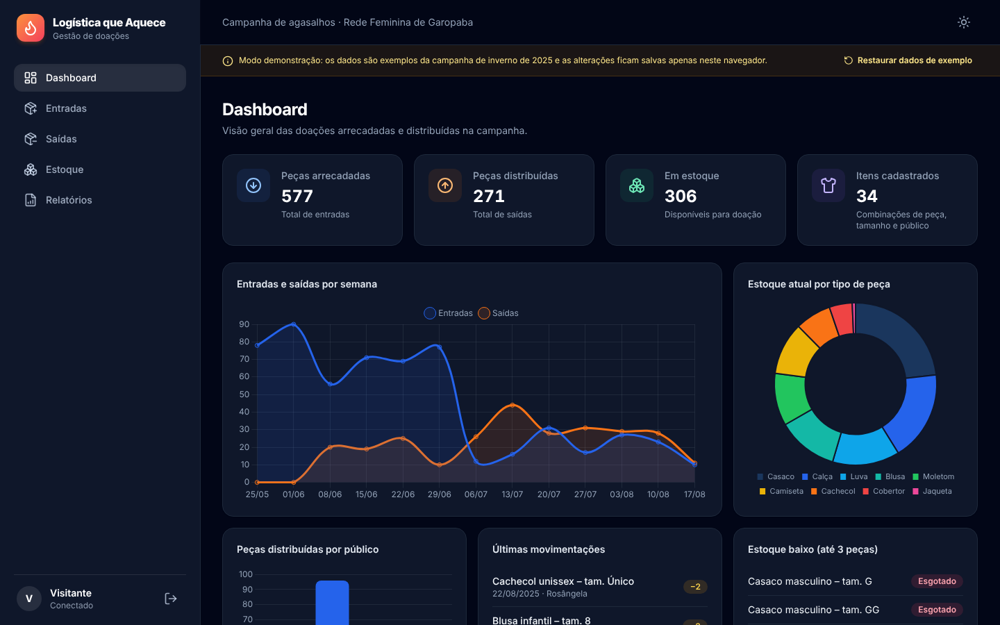

# 🧣 Logística que Aquece

Sistema web de gestão de doações criado para a campanha de agasalhos **Logística que Aquece**, promovida pelo **SENAI** com a **Rede Feminina de Garopaba (SC)** no inverno de 2025.

O sistema registra as roupas arrecadadas, controla as retiradas para distribuição e mantém o estoque atualizado, com relatórios que dão transparência ao que foi recebido e doado. Foi o primeiro sistema que desenvolvi.



> **Sobre esta versão:** o código-fonte original se perdeu depois da campanha. Este repositório é uma **reconstrução fiel**, feita a partir da configuração original do projeto (dependências, Vite, Tailwind e TypeScript) e das funcionalidades do sistema que foi usado na campanha.

## ✨ Funcionalidades

- **Login** de acesso ao sistema.
- **Dashboard** com o total de peças arrecadadas, distribuídas e em estoque, além de gráficos de entradas e saídas por semana, estoque por tipo de peça e distribuição por público.
- **Entradas:** registro das doações recebidas, com tipo da peça, tamanho, público, quantidade, data e responsável pelo recebimento.
- **Saídas:** registro das retiradas, com item, quantidade, data e responsável. O sistema impede retirar mais peças do que há em estoque.
- **Estoque:** saldo de cada peça calculado a partir das entradas e saídas, com filtros e alerta de estoque baixo ou esgotado.
- **Relatórios** de movimentações, resumo por tipo de peça e estoque atual, com filtro de período e exportação em **PDF**, **Excel** e **CSV**.
- **Modo claro e escuro** e layout responsivo para celular.

| Estoque | Relatórios |
| --- | --- |
|  |  |

| Login | Modo escuro |
| --- | --- |
|  |  |

<p align="center"></p>

## 🛠️ Tecnologias

| Camada           | Ferramentas                                                    |
| ---------------- | -------------------------------------------------------------- |
| Front-end        | React 18, TypeScript, Vite, React Router                       |
| Estilização      | Tailwind CSS, Framer Motion, Lucide Icons                      |
| Back-end / Dados | Supabase (PostgreSQL + autenticação)                           |
| Gráficos         | Chart.js, react-chartjs-2                                      |
| Relatórios       | jsPDF + jsPDF-AutoTable (PDF), SheetJS (Excel), PapaParse (CSV)|
| Validação        | Zod                                                            |
| Qualidade        | ESLint, TypeScript (`strict`), Vitest, GitHub Actions          |

## 🚀 Como rodar

Pré-requisito: [Node.js](https://nodejs.org/) 20 ou superior.

```bash
npm install
npm run dev
```

Acesse `http://localhost:5173` e entre com:

| Usuário     | Senha       |
| ----------- | ----------- |
| `Visitante` | `Visitante` |

Sem configuração nenhuma, o sistema roda em **modo demonstração**, com dados de exemplo da campanha salvos no próprio navegador. O botão "Restaurar dados de exemplo" desfaz as alterações.

### Usando o Supabase (opcional)

1. Crie um projeto no [Supabase](https://supabase.com/) e execute o script [`supabase/schema.sql`](supabase/schema.sql) no SQL Editor. Ele cria as tabelas, a validação de estoque e as políticas de acesso.
2. Em **Authentication › Users**, crie o usuário `visitante@logisticaqueaquece.local` com a senha desejada.
3. Copie o `.env.example` para `.env` e preencha a URL e a chave `anon` do projeto.

Com as variáveis preenchidas, o sistema passa a usar o banco de dados em vez do modo demonstração.

## 📜 Scripts

| Comando             | Descrição                                   |
| ------------------- | ------------------------------------------- |
| `npm run dev`       | Servidor de desenvolvimento                 |
| `npm run build`     | Verificação de tipos e build de produção    |
| `npm run preview`   | Pré-visualização do build                   |
| `npm test`          | Testes automatizados (Vitest)               |
| `npm run lint`      | Análise estática com ESLint                 |
| `npm run typecheck` | Verificação de tipos com TypeScript         |

## 📁 Estrutura

```
src/
├── components/   # Layout, rota protegida, tabela de movimentações e componentes de interface
├── contexts/     # Autenticação, estoque, tema e avisos
├── data/         # Fontes de dados: Supabase e modo demonstração (com dados de exemplo)
├── lib/          # Regras de estoque, validação, relatórios, gráficos e formatação
└── pages/        # Login, Dashboard, Entradas, Saídas, Estoque e Relatórios
supabase/
└── schema.sql    # Tabelas, gatilho de validação de estoque e políticas de acesso
```

## 👤 Autor

**Higor Cardoso**: [GitHub](https://github.com/higornovocardoso)
