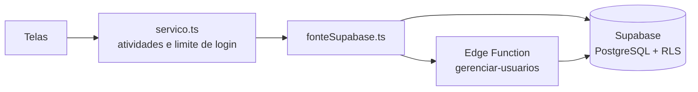
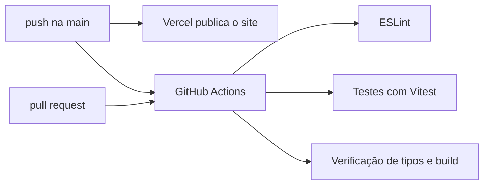

<div align="center">


# Logística que Aquece · Controle de estoque

**Campanha de agasalhos do SENAI com a Rede Feminina de Garopaba (SC)** · inverno de 2025

Sistema que registra as roupas recebidas como doação, o que sai para distribuição e o que é descartado na triagem, mantendo o estoque de cada peça sempre atualizado e com relatórios que dão transparência a todo o processo. Foi o primeiro sistema que desenvolvi.

[](https://logisticaqueaquece.vercel.app)
[](https://github.com/higornovocardoso/Logisteca-que-Aquece/actions/workflows/ci.yml)
[](#tecnologias)
[](LICENSE)

[**Ver o site**](https://logisticaqueaquece.vercel.app) · [LinkedIn](https://www.linkedin.com/in/higornovocardoso) · [GitHub](https://github.com/higornovocardoso)

</div>

> **Sobre esta versão:** o código original se perdeu depois da campanha. Este repositório é uma **reconstrução** feita a partir da configuração original do projeto, de capturas de tela do sistema usado na campanha e das funcionalidades que ele tinha, agora com melhorias e um visual novo.

---

## Sumário

- [Destaques](#destaques)
- [Capturas de tela](#capturas-de-tela)
- [Tecnologias](#tecnologias)
- [Estrutura do projeto](#estrutura-do-projeto)
- [Como funciona](#como-funciona)
- [Rodando localmente](#rodando-localmente)
- [Qualidade e automação](#qualidade-e-automação)
- [Segurança](#segurança)
- [Acessibilidade e desempenho](#acessibilidade-e-desempenho)
- [Licença](#licença)

## Destaques

- **Entradas, saídas e descartes.** Cada doação é registrada por tipo de peça, tamanho (Infantil, PP, P, M, G e GG; "Único" para acessórios), gênero, quantidade, fornecedor e quem recebeu. Saídas não passam do que há em estoque, e descartes guardam o motivo (rasgado, manchado, com mofo…).
- **Estoque sempre certo.** O saldo de cada peça é calculado a partir das movimentações, com código próprio (`CAS-F-M` = casaco feminino M), alertas de estoque baixo e esgotado e atalhos para registrar a saída direto da linha.
- **Registro rápido.** O botão *Registrar* está em todas as telas, as teclas <kbd>E</kbd>, <kbd>S</kbd> e <kbd>D</kbd> abrem cada formulário, <kbd>/</kbd> leva à busca e *Continuar registrando* agiliza a mesa de triagem.
- **Painel.** Indicadores com tendência semanal, o destino de todas as peças arrecadadas, gráficos por tipo, gênero, fornecedor e motivo de descarte, estoque crítico e últimos registros.
- **Relatórios.** Movimentações, resumo por tipo de peça, posição de estoque e doações por fornecedor, com filtro de período e exportação em **PDF**, **Excel** e **CSV**.
- **Administração.** Usuários com perfil (*Administrador* ou *Operador*), histórico de atividades (quem fez o quê e quando), backup em JSON (com cópia de segurança automática antes de qualquer importação) e limpeza dos dados para uma nova campanha.
- **Meu perfil.** Cada pessoa altera o próprio nome, o nome de usuário e a senha; o administrador também troca o nome de usuário de qualquer um.

## Capturas de tela

| Estoque | Relatórios |
| --- | --- |
|  |  |

| Registro de entrada | Administração |
| --- | --- |
|  |  |

| Tema escuro | Login |
| --- | --- |
|  |  |

<p align="center">
  
</p>

## Tecnologias

| Camada | Escolha | Por quê |
| --- | --- | --- |
| Interface | React 18 + TypeScript (`strict`), Vite e React Router | Telas tipadas de ponta a ponta e build rápido, com cada página carregada sob demanda |
| Visual | Tailwind CSS com tokens de cor próprios, fontes Geist e Lucide Icons | Tema claro e escuro a partir das mesmas variáveis; números alinhados em fonte mono |
| Movimento | Framer Motion | Transições curtas e com propósito, desligadas quando o sistema pede menos movimento |
| Dados | [Supabase](https://supabase.com): PostgreSQL, Auth, RLS e Edge Function | As regras ficam no próprio banco, não só na tela |
| Gráficos | Chart.js com react-chartjs-2 | Leve e fácil de adaptar às cores do tema |
| Relatórios | jsPDF + AutoTable, SheetJS e PapaParse | PDF, Excel e CSV gerados no navegador, carregados só quando alguém exporta |
| Validação | Zod | As mesmas regras nos formulários e na importação de backups; o banco repete as essenciais com restrições próprias |
| Hospedagem | [Vercel](https://vercel.com) | Publica sozinha a cada push na `main` |
| Qualidade | ESLint, Vitest e GitHub Actions | Lint, testes e build a cada push e pull request |

## Estrutura do projeto

```text
.
├── src/
│   ├── main.tsx                # ponto de entrada: carrega o sistema ou o aviso de configuração
│   ├── App.tsx                 # rotas e provedores (tema, avisos, sessão)
│   ├── paginas.ts              # páginas carregadas sob demanda e pré-carregamento
│   ├── assets/                 # logo do SENAI
│   ├── components/
│   │   ├── Layout.tsx          # menu lateral, topo, menu do usuário e transições
│   │   ├── RotaProtegida.tsx   # exige login e, quando preciso, perfil de administrador
│   │   ├── Registro.tsx        # formulários de entrada, saída e descarte (atalhos E, S e D)
│   │   ├── MeuPerfil.tsx       # nome, nome de usuário e senha da própria conta
│   │   ├── SemConfiguracao.tsx # aviso exibido quando falta o .env
│   │   └── ui.tsx              # modal, campos, abas, esqueletos e números animados
│   ├── pages/                  # Login, Painel, Entradas/Saídas/Descartes, Estoque, Relatórios, Administração
│   ├── contexts/               # sessão, estoque, tema e avisos
│   ├── data/
│   │   ├── index.ts            # instância única do serviço usada pelas telas
│   │   ├── fonte.ts            # contrato da fonte de dados
│   │   ├── fonteSupabase.ts    # acesso ao Supabase (banco, login e Edge Function)
│   │   └── servico.ts          # registro de atividades e limite de tentativas de login
│   ├── lib/                    # regras de estoque, validação, relatórios, backup e códigos dos itens
│   └── test/                   # dados de exemplo da campanha, usados só pelos testes
├── supabase/
│   ├── schema.sql              # tabelas, gatilhos e políticas de acesso (RLS)
│   ├── functions/gerenciar-usuarios/  # Edge Function: criar, remover e renomear usuários, redefinir senha
│   └── migracoes/              # ajustes para bancos criados antes da versão atual do schema
├── public/                     # ícone do site
├── docs/telas/                 # capturas usadas neste README
├── .github/workflows/ci.yml    # lint, testes e build a cada push
├── vercel.json                 # cabeçalhos de segurança e rotas
└── LICENSE                     # licença MIT
```

## Como funciona

### Do navegador ao banco



As telas falam com um contrato único (`FonteDeDados`), implementado sobre o Supabase. No meio, `servico.ts` registra cada ação no histórico e limita as tentativas de login. Tudo o que exige a chave de serviço (criar, remover e renomear usuários, redefinir senhas) passa pela Edge Function, que confere quem pediu antes de agir.

### O saldo nunca fica negativo

O estoque não é um número guardado: é a soma das entradas menos as saídas e os descartes de cada peça, recalculada a cada movimentação. Um gatilho no banco confere o saldo depois de cada registro e recusa qualquer saída, descarte ou exclusão que o deixaria negativo, mesmo que alguém tente pela API, sem passar pela tela.

### Quem pode o quê

| Ação | Operador | Administrador |
| --- | :---: | :---: |
| Registrar entradas, saídas e descartes | ✓ | ✓ |
| Consultar estoque, painel e relatórios | ✓ | ✓ |
| Alterar o próprio nome, nome de usuário e senha | ✓ | ✓ |
| Excluir registros | | ✓ |
| Criar, editar e remover usuários | | ✓ |
| Ver o registro de atividades, fazer backup e limpar dados | | ✓ |

Cada linha vale também no banco, por políticas de RLS e gatilhos: esconder um botão nunca é a única proteção.

## Rodando localmente

Pré-requisitos: [Node.js](https://nodejs.org) 20 ou mais novo e um projeto no [Supabase](https://supabase.com).

1. Execute [`supabase/schema.sql`](supabase/schema.sql) no SQL Editor do Supabase. Os arquivos de `supabase/migracoes/` servem só para bancos criados com versões anteriores do schema.
2. Publique a Edge Function de usuários com a [Supabase CLI](https://supabase.com/docs/guides/cli): `supabase link --project-ref <id-do-projeto>` e depois `supabase functions deploy gerenciar-usuarios`. Ela usa a chave de serviço, que fica só no servidor.
3. Em **Authentication › Sign In / Providers**, desative *Allow new users to sign up*: as contas são criadas apenas pelo sistema.
4. Em **Authentication › Users**, crie o primeiro usuário com o e-mail `seunome@logisticaqueaquece.local` e libere-o como administrador no SQL Editor:
   ```sql
   update public.perfis set perfil = 'Administrador', ativo = true, nome = 'Seu Nome' where usuario = 'seunome';
   ```
5. Clone o projeto, configure o `.env` e rode:
   ```bash
   git clone https://github.com/higornovocardoso/Logisteca-que-Aquece.git
   cd Logisteca-que-Aquece
   cp .env.example .env    # preencha a URL e a chave pública (publishable ou anon)
   npm install
   npm run dev             # abre em http://localhost:5173
   ```
6. Entre usando só `seunome` como nome de usuário. As demais pessoas são cadastradas em *Administração › Usuários*.

O `.env` não é versionado. Sem ele, o sistema mostra um aviso explicando o que configurar. Ao publicar na Vercel, cadastre as mesmas variáveis no painel do projeto e troque o endereço do Supabase na `Content-Security-Policy` do [`vercel.json`](vercel.json).

| Comando | O que faz |
| --- | --- |
| `npm run dev` | Servidor de desenvolvimento |
| `npm run build` | Verificação de tipos e build de produção |
| `npm run preview` | Serve o build de produção |
| `npm test` | Testes automatizados (Vitest) |
| `npm run lint` | Análise estática (ESLint) |

## Qualidade e automação



Os testes (`src/**/*.test.ts`) conferem, entre outras coisas, que:

- o saldo de cada item é calculado certo a partir das entradas, saídas e descartes;
- o login avisa quantas tentativas restam, bloqueia após 5 erros e cada ação vai para o histórico;
- os formulários recusam dados inválidos, como quantidades fracionadas, descarte sem motivo e senhas que não conferem;
- backups adulterados são recusados antes de apagar qualquer dado, e backups antigos são convertidos para os tamanhos atuais;
- relatórios e códigos dos itens dão o resultado esperado.

As regras de permissão e de estoque também são garantidas pelo próprio banco (RLS e gatilhos) e foram testadas direto no Supabase, simulando operadores, usuários desativados e acessos sem login.

## Segurança

O sistema passou por uma rodada de testes de ataque contra o banco, a Edge Function e a interface. O que ficou valendo:

- **Regras no banco.** Políticas de RLS em todas as tabelas, funções de permissão em um schema que a API não expõe e gatilhos que impedem estoque negativo, mudança do próprio perfil de acesso e registros em nome de outra pessoa ou com data retroativa.
- **Contas.** Só o sistema cria contas: quem se cadastrar por fora fica sem acesso até um administrador liberar. Senhas com no mínimo 8 caracteres, guardadas com bcrypt pelo Supabase.
- **Login.** Até 5 tentativas a cada 15 minutos na tela, além do limite do próprio Supabase.
- **Exportações e backups.** O CSV neutraliza fórmulas de planilha. Backups são validados antes de qualquer alteração, e o sistema baixa uma cópia dos dados atuais antes de importar.
- **Site.** Cabeçalhos em [`vercel.json`](vercel.json): `Content-Security-Policy`, HSTS, `Permissions-Policy`, `X-Frame-Options` e `nosniff`. Nenhum segredo vai para o navegador; a chave de serviço existe só dentro da Edge Function.

## Acessibilidade e desempenho

- **Carregamento.** A tela de login baixa menos da metade do JavaScript do sistema. As demais páginas são pré-carregadas enquanto o navegador está ocioso, e PDF, Excel e gráficos só chegam quando são usados.
- **Menos movimento.** Com "reduzir movimento" ativado no sistema, contagens, transições e entradas em cascata são desligadas.
- **Teclado.** Foco visível em tudo que é clicável, atalhos para os registros e para a busca, e janelas que fecham com <kbd>Esc</kbd>.
- **Leitores de tela.** Números animados têm o valor final disponível para leitores de tela, e a barra com o destino das peças traz o resumo em texto.
- **Celular.** Todas as telas funcionam no celular, com menu lateral recolhível e janelas que sobem da parte de baixo.

## Licença

Distribuído sob a licença MIT. Veja [`LICENSE`](LICENSE) para mais detalhes.

O nome e a logo do SENAI, o nome da Rede Feminina de Garopaba e o conteúdo pessoal (textos, nomes e imagens) não estão cobertos pela licença.

---

<div align="center">
Feito por <a href="https://www.linkedin.com/in/higornovocardoso">Higor Cardoso</a> · Garopaba, SC
</div>
