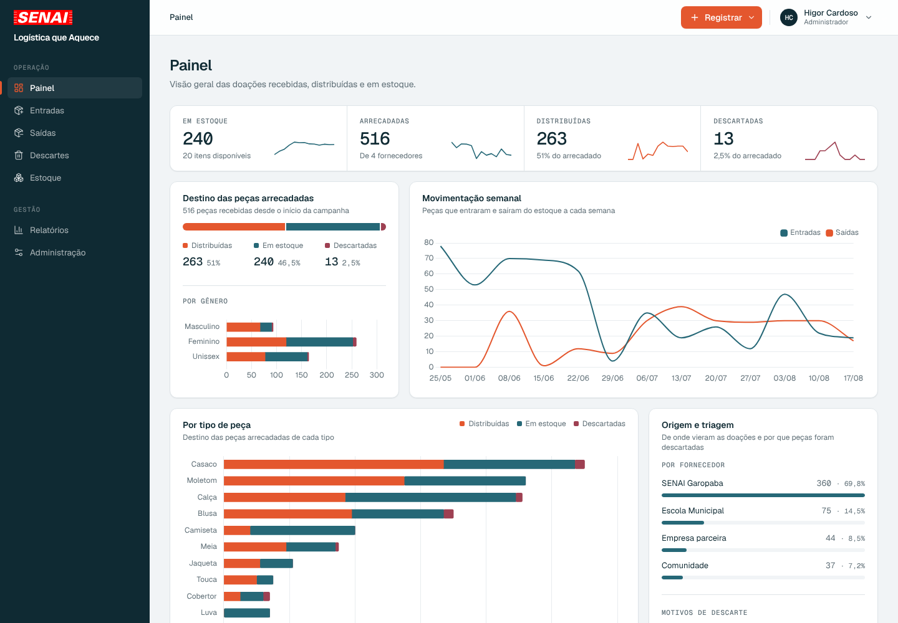
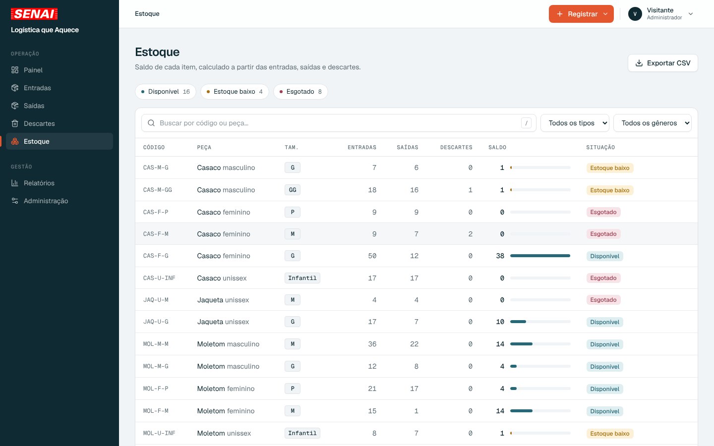
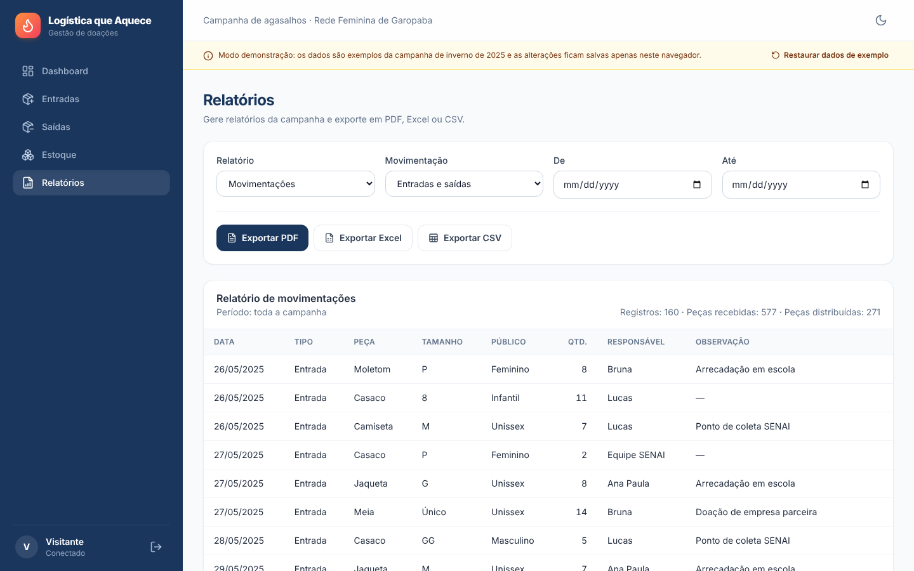
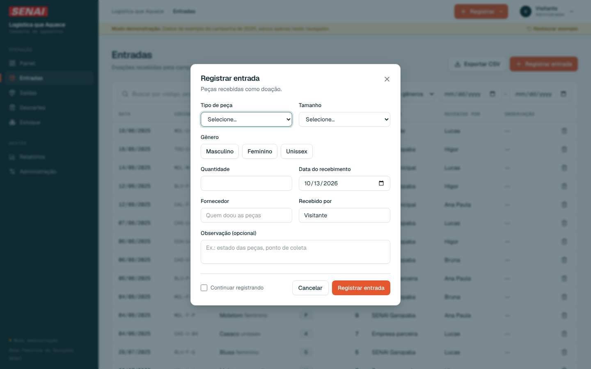
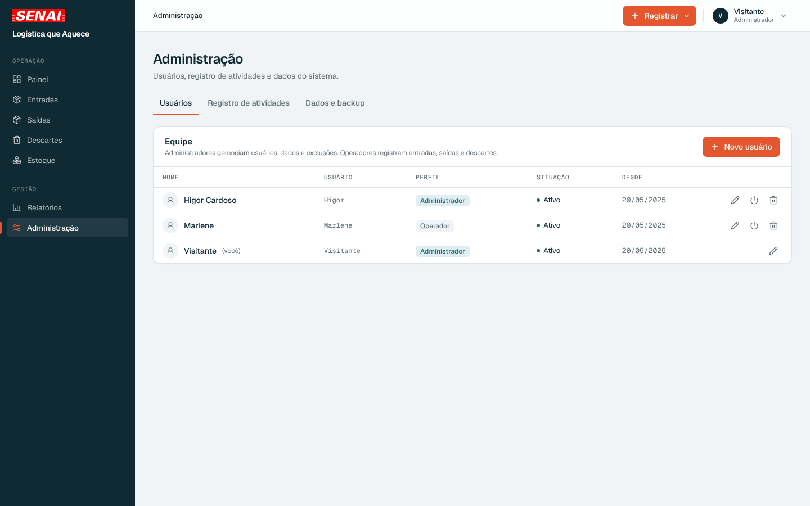
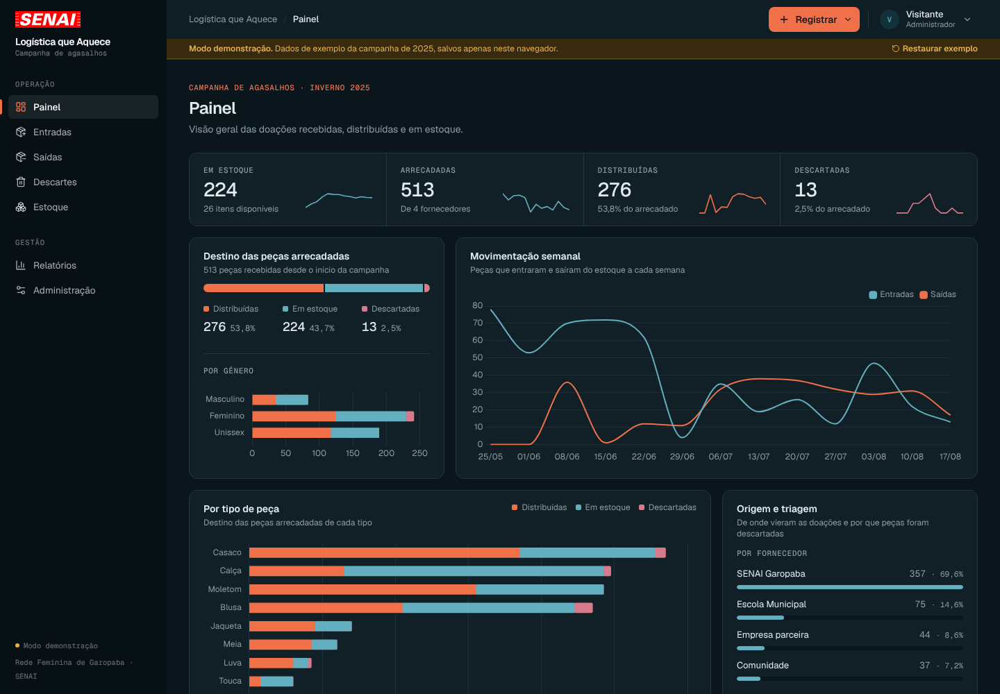
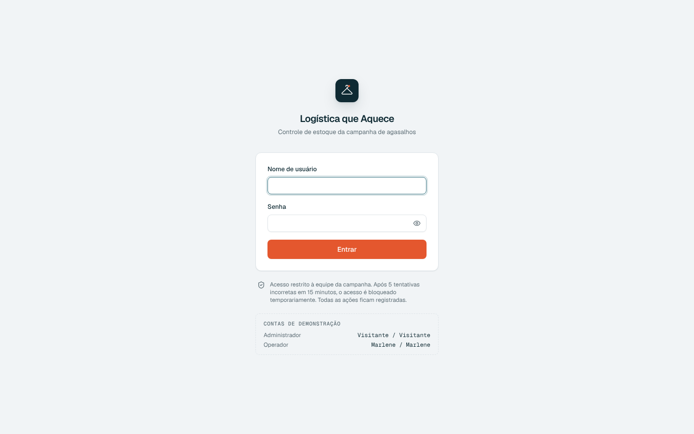
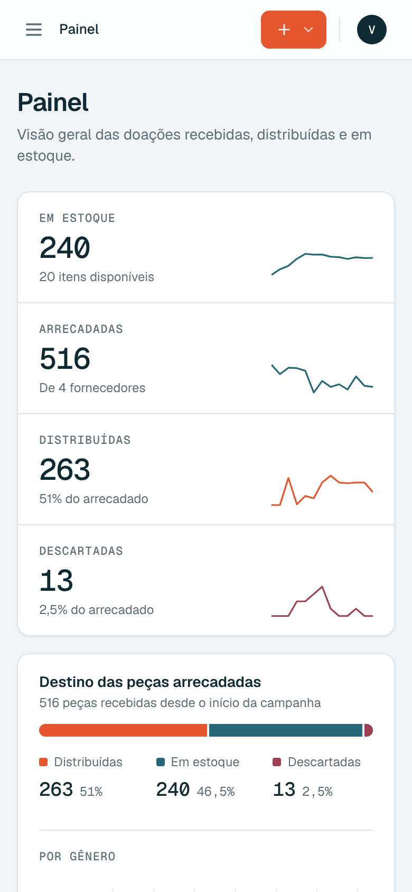

# Logística que Aquece

Sistema de controle de estoque da campanha de agasalhos **Logística que Aquece**, promovida pelo **SENAI** com a **Rede Feminina de Garopaba (SC)** no inverno de 2025.

O sistema registra as roupas recebidas como doação, controla o que sai para distribuição e o que é descartado na triagem, e mantém o estoque de cada peça sempre atualizado, com relatórios que dão transparência a todo o processo. Foi o primeiro sistema que desenvolvi.



> **Sobre esta versão:** o código original se perdeu depois da campanha. Este repositório é uma **reconstrução** feita a partir da configuração original do projeto, de capturas de tela do sistema usado na campanha e das funcionalidades que ele tinha, agora com melhorias e um visual novo.

## Funcionalidades

**Operação**
- **Entradas:** registro das doações por tipo de peça, tamanho, gênero, quantidade, fornecedor e responsável. A opção *Continuar registrando* agiliza o lançamento de várias peças em sequência na mesa de triagem.
- **Saídas:** retiradas para distribuição, com responsável. O sistema impede retirar mais peças do que há em estoque.
- **Descartes:** peças sem condições de uso, com o motivo (rasgada, manchada, com mofo…).
- **Estoque:** saldo de cada item com código próprio (ex.: `CAS-F-M` = casaco feminino M), filtros, alertas de estoque baixo e esgotado, e atalhos para registrar a saída ou o descarte direto da linha.
- **Registro rápido:** botão *Registrar* em todas as telas e atalhos de teclado <kbd>E</kbd>, <kbd>S</kbd> e <kbd>D</kbd>.

**Gestão**
- **Painel:** indicadores com tendência semanal, o destino de todas as peças arrecadadas (distribuídas, em estoque e descartadas), gráficos por tipo, gênero, fornecedor e motivo de descarte, estoque crítico e últimos registros.
- **Relatórios:** movimentações, resumo por tipo de peça, posição de estoque e doações por fornecedor, com filtro de período e exportação em **PDF**, **Excel** e **CSV**.
- **Meu perfil:** cada usuário, administrador ou operador, altera o próprio nome e troca a própria senha, confirmando a senha atual.
- **Administração:** usuários com perfil (*Administrador* ou *Operador*), registro de todas as atividades (quem fez o quê e quando), backup em JSON, importação de backup e limpeza dos dados para uma nova campanha.

**Segurança**
- Login com no máximo 5 tentativas a cada 15 minutos, com bloqueio temporário e contagem regressiva.
- Senhas guardadas apenas como hash (PBKDF2 no modo demonstração e bcrypt no Supabase).
- Permissões por perfil: operadores registram, administradores também excluem registros, gerenciam usuários e dados.
- No Supabase, as regras ficam no próprio banco: políticas de acesso (RLS) e gatilhos que impedem estoque negativo, garantem a autoria do registro de atividades e impedem que alguém mude o próprio perfil de acesso.

| Estoque | Relatórios |
| --- | --- |
|  |  |

| Registro de entrada | Administração |
| --- | --- |
|  |  |

| Tema escuro | Login |
| --- | --- |
|  |  |

<p align="center"></p>

## Tecnologias

| Camada           | Ferramentas                                                      |
| ---------------- | ---------------------------------------------------------------- |
| Front-end        | React 18, TypeScript, Vite, React Router                         |
| Interface        | Tailwind CSS, Framer Motion, Lucide Icons, fontes Geist          |
| Back-end / dados | Supabase (PostgreSQL, Auth, RLS)                                 |
| Gráficos         | Chart.js, react-chartjs-2                                        |
| Relatórios       | jsPDF + AutoTable (PDF), SheetJS (Excel), PapaParse (CSV)        |
| Validação        | Zod                                                              |
| Qualidade        | ESLint, TypeScript (`strict`), Vitest, GitHub Actions            |

## Como rodar

Pré-requisito: [Node.js](https://nodejs.org/) 20 ou superior.

```bash
npm install
npm run dev
```

Acesse `http://localhost:5173`.

### Modo demonstração

Sem configurar nada, o sistema roda em **modo demonstração**, com os dados de exemplo da campanha salvos no próprio navegador:

| Perfil        | Usuário     | Senha       |
| ------------- | ----------- | ----------- |
| Administrador | `Visitante` | `Visitante` |
| Operador      | `Marlene`   | `Marlene`   |

Em *Administração › Dados e backup*, o botão *Restaurar* desfaz as alterações.

### Com o Supabase

1. Crie um projeto no [Supabase](https://supabase.com/) e execute o script [`supabase/schema.sql`](supabase/schema.sql) no SQL Editor.
2. Publique a Edge Function de usuários: `supabase functions deploy gerenciar-usuarios`. Ela cria, remove e redefine a senha de usuários com a chave de serviço, que fica só no servidor.
3. Em **Authentication › Users**, crie o primeiro administrador com o e-mail `seunome@logisticaqueaquece.local`. Em *User Metadata*, informe `{"nome": "Seu Nome", "perfil": "Administrador"}`.
4. Copie o `.env.example` para `.env` e preencha a URL e a chave pública (*publishable* ou `anon`) do projeto.
5. Entre no sistema usando só `seunome` como nome de usuário. Os demais usuários são criados em *Administração › Usuários*.

## Scripts

| Comando             | Descrição                                   |
| ------------------- | ------------------------------------------- |
| `npm run dev`       | Servidor de desenvolvimento                 |
| `npm run build`     | Verificação de tipos e build de produção    |
| `npm run preview`   | Pré-visualização do build                   |
| `npm test`          | Testes automatizados (Vitest)               |
| `npm run lint`      | Análise estática com ESLint                 |
| `npm run typecheck` | Verificação de tipos com TypeScript         |

## Estrutura

```
src/
├── components/   # Layout, formulários de registro, rotas protegidas e componentes de interface
├── contexts/     # Autenticação, estoque, tema e avisos
├── data/         # Fontes de dados (Supabase e modo demonstração), serviço com registro de atividades
├── lib/          # Regras de estoque, validação, relatórios, backup, limite de login e gráficos
└── pages/        # Login, Painel, Entradas/Saídas/Descartes, Estoque, Relatórios e Administração
supabase/
├── schema.sql    # Tabelas, gatilhos, políticas de acesso (RLS) e funções de permissão
└── functions/
    └── gerenciar-usuarios/   # Edge Function: criar, remover e redefinir senha de usuários
```

## Autor

**Higor Cardoso**: [GitHub](https://github.com/higornovocardoso)
